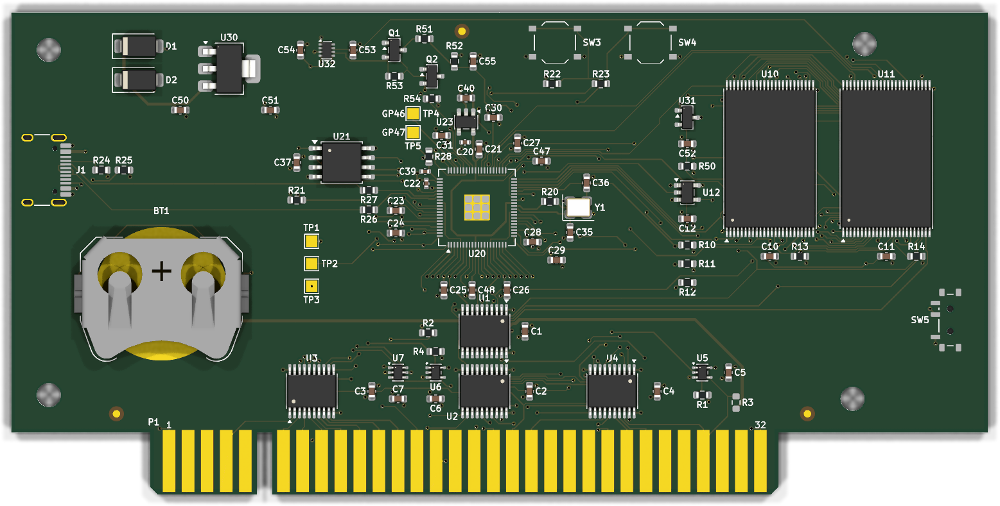

# TS-2068 Megabank

A battery-backed 4 MB RAM board for the Timex Sinclair 2068, built the way
Timex meant memory to grow: as **expansion banks** that can take over any 8K
chunk of the address space. It is a card for the expansion bus, for owners
of the TS-Pico v3.

It gives the 2068:

- **Paged memory:** any 8K page of the 4 MB, mapped into any chunk with
  `OUT`s to the board's two ports, at full memory speed.
- **A RAM disk:** `SAVE "r:name"`, `LOAD "r:name"`, `CAT "r:"` and the rest,
  kept through power-off by a battery.
- **Streams on the RAM disk:** `OPEN #4,"r:log","w"`, then `PRINT #`,
  `INPUT #` and `CLOSE #`, as `f:` streams work on the SD card.
- **Timex's own bank calls:** BANK_ENABLE and the rest of the 2068's bank
  code map the board's banks.

**Status:** working in a 2068, and supported by
[TS-Pico 2.5](https://github.com/timex-sinclair-projects/tspico-firmware-build/releases/tag/v2.5)
(2026-11-20), the first TS-Pico release with the Megabank's support. Boards
1 and 2 are built and pass every test so far on a v3 card: the memory test
over all 4 MB, the RAM disk, `r:` streams, the Timex bank API, the
write-protect switch, and a power cut during a `SAVE`. Still to come:
the standby current measurement, PicoVideo's support on real hardware,
and `tpi:ram alloc`. The [specification](docs/spec.md) has the design and
every result; the board's KiCad project (on the TS-Pico v3's form factor)
is in [hardware/](hardware/README.md), and the controller's firmware in
[firmware/controller/](firmware/controller/README.md).



*The routed card (KiCad render, 2026-11-07), the same 130 × 64 mm shape as
the TS-Pico v3. Underside: [docs/images/megabank-bottom.png](docs/images/megabank-bottom.png).*

## Where the work lives

| Part | Repository |
|---|---|
| The board: schematic, PCB, the controller's firmware | here |
| The TS-Pico ROM (detection, the RAM disk's copy routine, `r:`, the Timex bank API) and the v3 firmware (bus sharing, the RAM disk's file system) | [tspico-firmware-build](https://github.com/timex-sinclair-projects/tspico-firmware-build) |
| PicoVideo's support (ignoring screen writes to mapped banks) | [PicoVideo](https://github.com/timex-sinclair-projects/PicoVideo) |
| The emulator model | [zesarux-tspico](https://github.com/timex-sinclair-projects/zesarux-tspico) |

## What it needs

- A **TS-Pico v3** card, in slot 1 of the expansion bus.
- **TS-Pico 2.5** or later: firmware 2.5 and ROM 2.5. `PRINT PEEK 101`
  gives 37 on ROM 2.5. The ROM finds the board at switch-on, and runs the
  same with or without it.

## Trying it

```
FORMAT "r:"
SAVE "r:hello" CODE 0,100
CAT "r:"
OPEN #4,"r:log","w": PRINT #4;"kept": CLOSE #4
SAVE "tpi:ram"
SAVE "tpi:ram backup mydisk"
```

A new board has no RAM disk until `FORMAT "r:"` makes one, at the top of
the board and half its size (`FORMAT "r:512"` for 512K). Over a disk that
holds files, FORMAT says how many and does it only when typed again within
a minute. `CAT "r:"` lists the RAM disk, `SAVE "tpi:ram"` reports on it,
and `tpi:ram backup` copies it to `mydisk.rdi` on the SD card
(`tpi:ram restore` puts it back).

The first test, before any board existed (2026-10-16), showed that nothing
on a 2068 with a TS-Pico answers the board's ports, FCh and FDh.

## Licences

| What | Licence | File |
|---|---|---|
| Hardware design files: schematic and PCB | CERN Open Hardware Licence v2, Permissive (CERN-OHL-P-2.0) | [LICENSE-hardware.txt](LICENSE-hardware.txt) |
| Software: the board's controller firmware (RP2350B), tools and test programs | MIT | [LICENSE](LICENSE) |
| Documentation (`docs/`, this README) | Creative Commons Attribution 4.0 (CC BY 4.0) | [LICENSE-docs.txt](LICENSE-docs.txt) |
